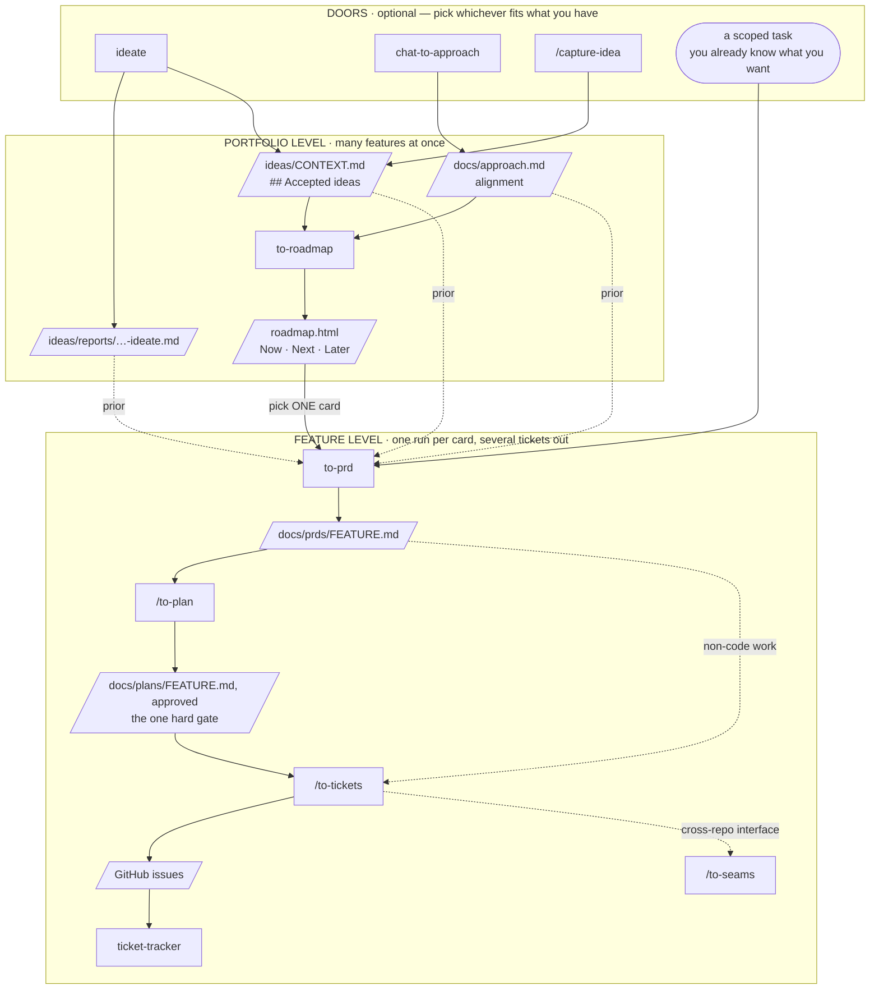

# Product workflow suite

Ten skills that take work from a raw idea, or an already-scoped task, through to tickets on a
board. This file is the map for humans working on the suite.

## Installing

Install all ten. The skills hand off to each other, so a partial install leaves those handoffs
dangling. (`artifact-scan` is the exception: every caller falls back to a one-line `ls`.)

```
for s in artifact-scan ideate chat-to-approach capture-idea to-roadmap to-prd to-plan to-tickets to-seams ticket-tracker; do
  npx skills add O-Marsters-1997/my-claude-code --skill "$s" -g -y
done
```

The suite must stay at `skills/workflow/<name>/`. The `skills` CLI discovers
`skills/<category>/<name>/SKILL.md` and nothing deeper. When the suite briefly lived at
`skills/product/workflow/<name>/`, `npx skills add` could not see it, and six of the eight skills it
held went uninstalled with no error. Nesting one directory further to tidy things up breaks
installation the same way.

The routines the suite calls install the same way. `grilling`, `source-synthesis` and `triage-issue`
live in `skills/product/`. `file-issue`, `sweep`, `pr`, `fix-ci`, `fleet` and `implement` live in
`skills/workflow/`.

Keep every `description` a folded block scalar (`description: >`). A plain one-line description
containing `": "` is invalid YAML, and a skill whose frontmatter won't parse is dropped from
`npx skills add --list` without any error. After editing a description, run:

```
grep -l '^description: [^>|].*: ' skills/*/*/SKILL.md   # must print nothing
```

---

Skills must not reference this file. Installation is flat: each skill lands in its own directory
under the agent's skills root, so `../README.md` does not resolve once installed, and the map would
be unreachable when it's needed. So the six skills on the main path (`artifact-scan`,
`chat-to-approach`, `to-roadmap`, `to-prd`, `to-tickets` and `ticket-tracker`) each carry their own
`## Where this sits` block: the same diagram, an arrow marking the skill's position, and the two
rules below. `ideate`, `capture-idea`, `to-plan` and `to-seams` have no such block. When the shape of
the suite changes, update this file and those six blocks.

## The shape



Boxes are skills and slanted boxes are the artifacts they write. Solid arrows are the path, and
dashed arrows are optional priors that make a stage faster and better informed. `/to-plan`,
`/to-tickets` and `/to-seams` are slash-only, and so are `to-prd`, `to-roadmap`, `chat-to-approach`
and `capture-idea`. Code work runs `to-prd → to-plan → to-tickets`. Non-code work skips the plan and
runs `to-prd → to-tickets`.

## Two rules that explain everything else

### 1. The spine runs per feature. The portfolio artifacts describe many features.

`approach.md` and `roadmap.html` are portfolio level: they hold every feature you're considering.
`to-prd`, `to-plan` and `to-tickets` each handle one feature per run.

A roadmap card is a feature, something that should be built, and not a ticket. It breaks down into
several tickets, and that happens at `to-tickets`, three stages later. `roadmap.html` and the
`ticket-tracker` board show the same work at different altitudes. Neither is a copy of the other.

Going from portfolio to feature is a fan-out, not a step. A roadmap with six cards means six
independent spine runs, each ending in its own handful of tickets. When a spine skill is handed a
portfolio artifact, its first job is to establish which feature it is for, and to ask if that isn't
obvious.

### 2. Never send the user backwards.

Every skill runs standalone. Upstream artifacts make a stage faster and better informed, but a
missing one is written inline or offered, and is never a reason to stop and run another skill first.
`to-prd` with an approach doc skips the questions it can already answer, and `to-prd` with nothing
runs the full interview. Both are correct.

The one hard gate is an approved plan. Code tickets are not cut until the user has reviewed
`docs/plans/<feature>.md`. `to-plan` checks whether the plan is gitignored and says so in its closing
message. When it is, local review is the gate rather than a PR, and each ticket carries its own copy
of the signatures it implements. Everything else stays loosely coupled, so each stage can be
iterated on alone as well as in sequence.

## The skills

| Skill | Level | Takes | Produces |
|---|---|---|---|
| `artifact-scan` | none | nothing | a report and one routing recommendation (also the preflight routine) |
| `ideate` | portfolio | the codebase | `./ideas/reports/YYYY-MM-DD-ideate.md`, `./ideas/CONTEXT.md` with `## Accepted ideas` |
| `chat-to-approach` | portfolio | a pasted conversation | `./docs/approach.md` |
| `capture-idea` | portfolio | one ad-hoc idea | a line in `## Accepted ideas` in `./ideas/CONTEXT.md` |
| `to-roadmap` | portfolio | `./docs/approach.md`, `## Accepted ideas`, or a user list | `./ideas/roadmap.html` |
| `to-prd` | feature | anything above, or an interview | `./docs/prds/<feature>.md`, and a GitHub issue only if requested |
| `to-plan` | feature | a PRD | `./docs/plans/<feature>.md`: usage examples and signatures per slice |
| `to-tickets` | feature | a PRD, or an approved plan | GitHub issues, plus command-centre `[[task]]` blocks (or a treepad Batch Manifest when command-centre is absent) and `seams[]` |
| `to-seams` | feature | an agreed cross-repo interface | a seam file, plus the `[[seam]]` block command-centre reads |
| `ticket-tracker` | feature | GitHub issues | `status:*` label moves |

## Orchestrators and routines

The convention across the suite:

> A user-invoked skill orchestrates a workflow and may call model-invoked routines. A routine is not
> triggered directly by the user. Another skill's flow delegates to it.

Every suite skill is an orchestrator except `artifact-scan`, which is both: a front door when the
user asks, a preflight when a skill calls it. `to-prd`, `to-plan`, `to-tickets`, `to-seams`,
`to-roadmap`, `chat-to-approach`, `capture-idea` and `sweep` are slash-only
(`disable-model-invocation: true`). Not every feature warrants both a plan and tickets, and while
`to-plan` and `to-tickets` were model-invocable they collided on prompts like "break this PRD down
into work". `capture-idea` is gated because it otherwise collides with `ideate` on "give me an
idea".

The routines below are not stages and never appear in the map. Some live in `skills/product/`, and
the rest sit beside the suite:

| Routine | Called by | For |
|---|---|---|
| `grilling` | `chat-to-approach`, `to-prd` | the canonical grilling loop, never re-inlined |
| `source-synthesis` | nobody, run it yourself | the optional `## Background Research` section of `approach.md`; `chat-to-approach` only preserves it |
| `triage-issue` | `ticket-tracker` | bug-driven tickets, a second door straight to the board that bypasses the spine |
| `file-issue` | nobody, run it yourself | one ad-hoc ticket with no feature label, picked up by `/implement`, a third door to the board. Its inbox mode files a bare `inbox` issue for `/sweep` |
| `sweep` | nobody, run it yourself | many small fixes (the `inbox` issues plus any pasted) clustered by file into tickets under one `sweep-YYYY-MM-DD` label, run with `/fleet dispatch`, a fourth door to the board |
| `pr` | whoever opens a PR; it triggers on its own description | the draft PR's title and body: visual Summary, Evidence, Merge Danger, `Closes` lines |
| `fix-ci` | nobody, run it yourself | red checks on PRs `/implement` or `/fleet` opened: diagnose from the failed logs, one cheap local check, push, watch CI in the background. Takes a run, a job, a PR, or nothing |
| `implement` | `/fleet`, or you | one ticket or spec through to a draft PR. Slash-only, never invoked on the model's own initiative |
| `fleet` | nobody, run it yourself | `dispatch`, `land` and `reconcile` over a feature label's tickets, one worktree and subagent per ticket |

## Not in scope

The suite stops at tickets. `/implement` and `/fleet` (both beside it in this directory) and code
review carry them to merged code. v2 runs through to code review, with the plan's signatures, copied
into each ticket, as the constraint the review checks against.
